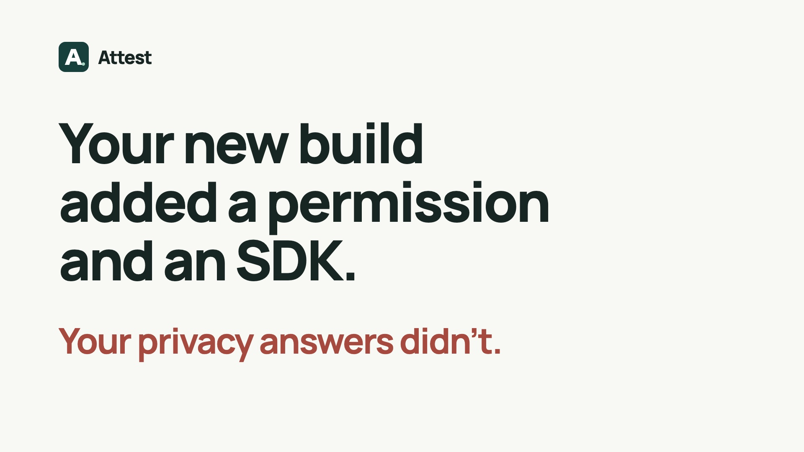

<p align="center">
  
</p>

<h1 align="center">Attest</h1>

<p align="center"><strong>Your new Android build added a permission and an SDK. Did your privacy answers keep up?</strong></p>

<p align="center">
  <a href="https://attest-ruby.vercel.app"><strong>Website &amp; Interactive Walkthrough</strong></a> ·
  <a href="https://attest-ruby.vercel.app/#try">Try in Browser</a> ·
  <a href="https://attest-ruby.vercel.app/guide.html">Local CLI Guide</a> ·
  <a href="docs/ARCHITECTURE.md">Architecture</a> ·
  <a href="LICENSE">Apache-2.0</a>
</p>

<p align="center">
  <a href="https://github.com/AminSS99/Attest/actions/workflows/ci.yml"></a>
  <a href="https://attest-ruby.vercel.app"></a>
  <a href="LICENSE"></a>
</p>

> **See how Attest works on the live website: [https://attest-ruby.vercel.app](https://attest-ruby.vercel.app)**
>
> The website walks through the full release flow visually — from the **32-second interactive demo video** and step-by-step **Release Delta → Truth Gaps → Release Passport → Reviewer Twin → Evidence Capsule** breakdown, to an **in-browser analyzer** where you can drop two APKs/AABs or run the synthetic PulseFit sample with nothing uploaded.

<p align="center">
  <a href="https://attest-ruby.vercel.app">
    
  </a>
</p>

---

Attest diffs your last shipped Android APK or AAB against a release candidate and checks the result against your Google Play Data Safety answers, privacy policy, store listing, and human-guided reviewer journey. Every finding cites the exact bytes that prove it. It runs locally — no source code required, no builds uploaded.

```text
$ npm run attest -- check \
    --base attest-out/demo/pulsefit-1.2.0.apk \
    --candidate attest-out/demo/pulsefit-1.3.0.apk \
    --data-safety attest-out/demo/data-safety.json

attest check — pulsefit-1.2.0.apk -> pulsefit-1.3.0.apk
delta: +1 perms, -1 perms, +1 SDKs, +1 destinations, +1 exported components

[HIGH] F-594f69a48b5990e1 TG-002 — New third-party SDK without any disclosure
  state: confirmed contradiction
  New SDK Amplitude Analytics (Amplitude) is present in the build but disclosed nowhere the team has declared.
  comparison: observed(com.amplitude via com/amplitude) vs declared(no Data Safety disclosure, no privacy-policy mention)
  fix: Disclose the SDK and its data practices in the Data Safety form and privacy policy, or remove it from the build.

[HIGH] F-7716dd7492743738 TG-001 — New dangerous permission not covered by Data Safety answers
  state: confirmed contradiction
  Build declares android.permission.CAMERA (Camera (photos)), but the Data Safety form does not list "photos_and_videos.photos". One of them is wrong.
  comparison: observed(android.permission.CAMERA) vs declared(collectedDataTypes missing "photos_and_videos.photos")
  fix: Update the Data Safety form to disclose the data type, or remove the permission and the code path that requires it.

2 confirmed contradiction(s). Recommendation: HOLD until declarations match the build.   (exit code 2)
```

*(Excerpt from the synthetic PulseFit demo fixture, not a customer release.)*

## Try it in 60 seconds

### 1. In your browser (no install)

Open **[https://attest-ruby.vercel.app/#try](https://attest-ruby.vercel.app/#try)**, drop two `.apk` or `.aab` builds (plus an optional Data Safety `.json`), or click **"or run the synthetic PulseFit sample"**.

The browser analyzer compiles the exact same TypeScript parsers and rules engine into a Web Worker. Your builds are read in memory and never leave your machine.

### 2. From a clone (Node.js 20+)

Attest is not published to npm yet; run it directly from source:

```bash
git clone https://github.com/AminSS99/Attest.git
cd Attest
npm ci
```

Run the interactive website locally:

```bash
npm run web:dev    # opens http://127.0.0.1:4173
```

Or run the end-to-end synthetic CLI demo (produces a `HOLD` release, repairs it to `SHIP`, and verifies both sealed Evidence Capsules offline):

```bash
npm run demo
npm run attest -- verify attest-out/demo/capsule
```

Open `attest-out/demo/capsule/passport.html` to inspect the generated Release Passport.

## What Attest does

- **Reads Android builds without Android tooling.** ZIP, binary `AndroidManifest.xml` (AXML), and DEX string-table parsers are written from scratch in TypeScript with zero runtime dependencies. No `apktool`, no Java, no source code required.
- **Detects release-level truth gaps.** Five deterministic rules compare what changed in the binary (permissions, SDKs, network destinations, exported components) against what your declarations claim. See [`truthgap.ts`](packages/cli/src/truthgap.ts).
- **Separates fact from inference.** Every claim is tagged `observed`, `declared`, `attested`, `inferred`, or `missing`, and every finding links directly to its underlying evidence.
- **Captures a Reviewer Twin.** A human-guided ADB recorder logs each reviewer step, foreground activity, and screenshot hash, then flags the first step that changed or failed against an approved baseline.
- **Records the human release decision.** A **Release Passport** (HTML + JSON) recommends `SHIP`, `REVIEW`, or `HOLD`. Time-boxed exceptions overlay findings without erasing them, shipping over `HOLD` requires an explicit reason, and finalized decisions are immutable.
- **Seals evidence you can verify offline.** An **Evidence Capsule** hashes every artifact, declaration snapshot, journey step, and Passport with SHA-256 so `attest verify` can detect tampering without Attest servers.
- **Gates CI pull requests.** A [reusable GitHub Action](.github/actions/attest) writes a release-delta summary and SARIF report, uploads the Passport/Capsule as artifacts, and exits with code `2` on confirmed contradictions.

## Use it on your release

```bash
npm run build

# Scaffold and validate a local workspace (optional)
npm run attest -- init
npm run attest -- doctor

# Compare builds against your declarations
npm run attest -- check \
  --base path/to/last-shipped.apk \
  --candidate path/to/candidate.apk \
  --data-safety path/to/data-safety.json \
  --privacy-policy path/to/privacy.txt \
  --listing path/to/listing.txt

# Generate a Release Passport + sealed Evidence Capsule, then verify offline
npm run attest -- passport \
  --base path/to/last-shipped.apk \
  --candidate path/to/candidate.apk \
  --data-safety path/to/data-safety.json \
  --out evidence/

npm run attest -- verify evidence/
```

Run `npm run attest -- help` for all commands (`inspect`, `diff`, `check`, `journey`, `passport`, `exception`, `decide`, `seal`, `verify`, `init`, `doctor`). Exit code `2` indicates confirmed contradictions (`HOLD`), allowing CI pipelines to gate releases cleanly. Keep private builds and credentials outside this repository.

For GitHub Actions usage, see [`examples/github-action.yml`](examples/github-action.yml).

## Current scope & honesty

Attest is an early open-source developer preview (**Android only**):

- **Working and tested today:** APK/AAB inspection, two-build diffing, five declaration truth-gap rules, human-guided ADB Reviewer Twin, Release Passports, exceptions and immutable human decisions, offline Capsule verification, reusable GitHub Action, website showcase, and in-browser Web Worker analyzer.
- **Not yet built:** iOS build inspection, hosted release-history dashboard, published npm packages, and fully automated (non-guided) device journeys.
- **Validation boundary:** Automated tests and CI validate the engine on synthetic fixtures, and build-delta inspection has been exercised on [real public APKs](docs/REAL_RELEASES.md) (without private declarations). Attest supports human release decisions; it does not guarantee app store approval and is not legal advice or a compliance certification.

## Repository map

| Path | Purpose |
| --- | --- |
| [`packages/cli`](packages/cli) | Local CLI, binary parsers (ZIP/AXML/DEX), rules, Reviewer Twin, Passport, Capsule |
| [`packages/schema`](packages/schema) | Shared TypeScript types and JSON schemas for evidence and release records |
| [`apps/web`](apps/web) | Live website ([attest-ruby.vercel.app](https://attest-ruby.vercel.app)), local guide, and in-browser Web Worker analyzer |
| [`apps/video`](apps/video) | 32-second product walkthrough video and social assets built with [Remotion](https://www.remotion.dev) |
| [`.github/actions/attest`](.github/actions/attest) | Reusable GitHub Action with SARIF and step summary output |
| [`examples/github-action.yml`](examples/github-action.yml) | Example pull-request gate workflow |
| [`docs/ARCHITECTURE.md`](docs/ARCHITECTURE.md) | Pipeline architecture, parsers, and trust model |
| [`docs/REAL_RELEASES.md`](docs/REAL_RELEASES.md) | Findings and parser fixes from testing on real public APKs |
| [`PRODUCT_PLAN.md`](PRODUCT_PLAN.md) | Product specification and roadmap |

## Development

```bash
npm ci
npm test            # compile TypeScript packages and run all CLI/parser/e2e tests
npm run web:build   # bundle the browser worker and build the static site to apps/web/dist/
```

## Security & License

- **Security:** See [`SECURITY.md`](SECURITY.md) for private vulnerability reporting and artifact handling guidance.
- **License:** [Apache License 2.0](LICENSE).
